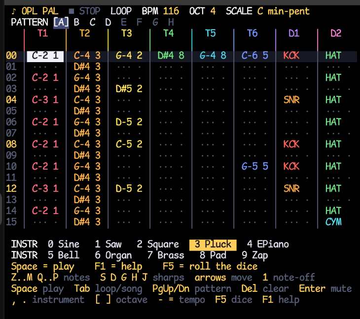

# OPL PAL

A tiny tracker for a pretend Sound Blaster. Real OPL3 sound (via the bundled
[Nuked-OPL3](https://github.com/nukeykt/Nuked-OPL3) emulator), a TUI, and a
little animated picture in terminals that speak the kitty graphics protocol
(kitty, Ghostty, WezTerm). Made to be learned in a minute and poked at while
something else is compiling.

## Run it

    sudo apt install build-essential      # once: the emulator is compiled on first run
    ./oplpal.py                           # starts with a demo song loaded

Needs Python 3 (stock on Ubuntu) and ALSA's `libasound.so.2`, which PipeWire
already provides on a normal Ubuntu desktop. No pip packages.

    ./oplpal.py mytune.json     open/save a specific file (default: oplpal-song.json)
    ./oplpal.py --no-gfx        text only
    ./oplpal.py --layout de     QWERTZ/AZERTY fallback for terminals other than kitty/Ghostty
    ./oplpal.py --wav out.wav   render the song to a file, no terminal needed
    OPLPAL_DEVICE=hw:0 ./oplpal.py   pick a different ALSA device

Terminal wants to be at least 70x24; 100+ columns puts the picture beside the
grid, narrower puts it underneath (needs ~34 rows).

## The 60-second version

Time runs down the screen. Each **column** is a voice, each **row** a 16th note.
Type a note and it drops in under the cursor, then the cursor steps down.
Press **Space**. That's it. Then press **F5** on a column for the dice.

| | |
|---|---|
| `Z X C V B N M` | C D E F G A B (`S D G H J` are the sharps) |
| `Q W E R T Y U I O P` | the same keys, one octave up |
| arrows / Home / End | move |
| `Space` | play / stop |
| `Tab` | LOOP (repeat this pattern) <-> SONG (play A, B, C... skipping empties) |
| `PgUp` / `PgDn` | switch pattern (A-H) |
| `Shift`+`←` `→` | instrument (10 FM patches, shown on screen; also `,` `.`) |
| `Shift`+`↑` `↓` | octave (also `[` `]`) |
| `F9` `F10` | tempo (also `-` `=`; `+`/`_` for +/-1) |
| `1` | note-off |
| `Del` / `Backspace` | clear cell |
| `Enter` | mute / unmute the column |
| `F5` | dice: invent a bass line / melody / beat for the current column |
| `F2` / `F3` | scale lock on/off and type / root note |
| `F6` `F7` `F8` | clear column / copy pattern to the next one / clear pattern |
| `Ctrl-S` `Ctrl-E` `Ctrl-Q` | save / export WAV / quit |
| `F1` or `?` | help |

Columns T1-T6 are melodic voices (alternately panned centre/left/right, which
is an OPL3 party trick). **D1 and D2 are drums** from the OPL rhythm section:
`Z` kick, `X` snare, `C` tom, `V` cymbal, `B` hat. There are two so you can
stack a kick and a hat on the same row.

The **scale lock** is on by default (C minor pentatonic): every key you press is
snapped into the scale, so you can't hit a wrong note. Press `F2` to cycle
through other scales or switch it off for chromatic freedom.

## Keyboard layouts (QWERTZ, AZERTY, ...)

The piano keys follow the *physical position* of the keys, like a real tracker,
so the layout of a piano on a German keyboard is the same as on a US one (Z is
the key where the US `Z` sits, even though it types `Y`).

* **kitty and Ghostty:** automatic. They report each key's US-position, and
  OPL PAL asks for it on startup. Nothing to configure, any layout works.
* **Other terminals:** no key positions available, so tell it your layout:
  `./oplpal.py --layout de` (or `fr`; also `OPLPAL_LAYOUT=de` in your shell
  profile). It prints a hint if your `LANG` is German or French.
  On `fr` the key typing `,` is the B note, so use Shift+arrows for instruments.
* The command keys that aren't piano keys (`Space`, arrows, `F`-keys, `Shift`+arrows)
  are layout-proof; the optional punctuation shortcuts use whatever the key types.
* `--no-kbd` turns off the position reporting if some terminal misbehaves.
* Need another layout? Add a few lines to `LAYOUTS` in `oplpal.py`.

## Notes

* Fixed 16 rows per pattern, 8 patterns, 4 rows per beat. Each column plays one
  note at a time; a note rings until the next note, a `1` note-off, or the end.
* Instruments are plain 2-operator OPL patches defined at the top of
  `oplpal.py` (`INSTRUMENTS`). Edit or add some; each is one line per operator.
  The drum kit is `DRUM_KIT` right below.
* Saved songs are readable JSON.

## Files

    oplpal.py     the tracker
    oplshim.c     12 lines of C glue so Python can drive the emulator
    opl3.c/.h     Nuked-OPL3 1.8 (LGPL-2.1+, (c) Nuke.YKT) - unmodified

Because Nuked-OPL3 is LGPL, its source ships alongside; the rest is yours to
do what you like with.
